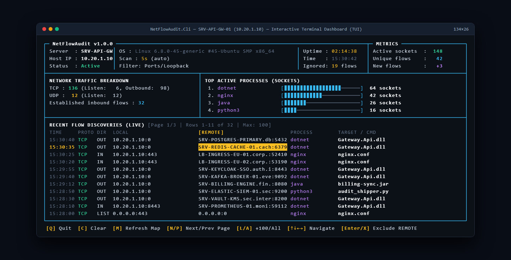
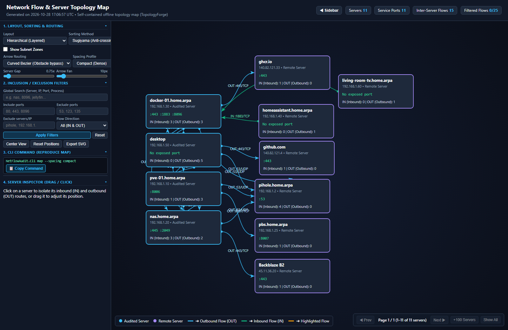

# NetFlowAudit - Continuous Network Flow Auditing Agent

<p align="center">
  
</p>

**NetFlowAudit** is a cross-platform (Windows and Linux) network flow auditing agent designed to run either interactively in the terminal or continuously as a background service/daemon. It inspects all inbound, outbound, and listening TCP/UDP sockets, identifies the local processes and application targets responsible for network activity, logs deduplicated flows to an RFC 4180 CSV file, and generates self-contained offline HTML5 topology maps.

---

## Preview

### Interactive Terminal Dashboard (TUI)
<p align="center">
  
</p>

### Self-Contained Offline HTML5 Network Topology Map (`TopologyForge`)
<p align="center">
  
</p>

---

## Why NetFlowAudit? (The Problem It Solves)

When preparing infrastructure migrations, establishing strict firewall whitelists, or conducting security audits, system administrators and security engineers face a recurring question: **"Which services does this machine actually communicate with over time, and which local application is responsible?"**

Existing tools often fall into extremes:
- **Packet sniffers (Wireshark, tcpdump)** require third-party kernel drivers (`Npcap`, `libpcap`), generate massive PCAP files, and do not inherently associate local process command-lines with network sockets.
- **Point-in-time snapshots (`netstat`, `ss`, `TCPView`)** only capture active connections at that exact instant, completely missing short-lived, transient, or scheduled night jobs.
- **Security event loggers (Sysmon Event ID 3)** log every individual connection without aggregating ephemeral ports, quickly flooding disks and SIEMs with millions of lines.
- **Active network scanners (Nmap, port scanners)** probe machines from the outside, generating aggressive network traffic that triggers IDS/EDR alerts.

**NetFlowAudit fills this gap:**
1. **Zero Capture Drivers**: Uses only native OS APIs (`iphlpapi.dll` on Windows, `/proc` on Linux) with zero driver installation.
2. **Continuous & Deduplicated**: Sits quietly in the background, collapsing ephemeral client ports into a clean, consolidated RFC 4180 CSV audit trail tracking `FirstSeen`, `LastSeen`, and cumulative hit counts.
3. **Deep Target Unwrapping**: Identifies the true underlying application payload behind generic launchers (`java -jar service.jar`, `python script.py`, `powershell task.ps1`, `dotnet app.dll`).
4. **Instant Self-Contained Topology Maps**: Generates interactive HTML5/SVG network graphs that can be opened in any browser offline, with no backend or cloud dependencies.

---

## 1. Key Features

- **Zero Third-Party Packet Capture Drivers**: Requires neither Npcap, WinPcap, nor libpcap.
  - **Windows**: Queries native Win32 IP Helper APIs (`iphlpapi.dll`).
  - **Linux / WSL**: Reads `/proc/net/{tcp,tcp6,udp,udp6}` and correlates socket inodes across `/proc/<pid>/fd`.
- **Underlying Application Target Detection (Wrapper Unwrapping)**: Goes beyond identifying generic launcher binaries (`java.exe`, `python`, `cmd.exe`, `powershell.exe`, `bash`, `dotnet`) by parsing the full command line and extracting the real payload (`.jar`, `.py`, `.bat`, `.cmd`, `.ps1`, `.sh`, `.dll`).
- **Non-Blocking Asynchronous Reverse DNS & RDAP Fallback**:
  - Automatically resolves remote IP addresses to hostnames (FQDN) in the background.
  - Persistent disk cache (`netflow_dns_cache.json`) with negative-caching policy and RDAP organization fallback when PTR records are absent.
  - Supports `--isolated` / `--offline` mode for air-gapped environments.
- **Smart Flow Deduplication**:
  - Neutralizes ephemeral client ports on outbound connections so repeated connections to the same remote service port do not flood the audit log.
  - Tracks `FirstSeenUtc`, `LastSeenUtc`, and cumulative `ObservationCount`.
  - Automatically reloads existing CSV history on startup to preserve continuity across restarts.
- **Process & Network Filtering**:
  - Exclude processes by PID, exact name, prefix, suffix, substring, or system accounts (`SYSTEM`, `root`).
  - Automatic exclusion of loopback/intra-host traffic (`LocalIp == RemoteIp`, `127.0.0.0/8`, `::1`).
  - Interactive live exclusion of Local Ports, Remote IPs/CIDRs, Processes, and Targets directly from the terminal dashboard.
- **Responsive Terminal Dashboard (TUI) with Pagination**:
  - Full-screen ANSI interface adapting dynamically to terminal width and height.
  - Paginated live flow discovery table with clamped row navigation (`[N/P]` or `[PgDn/PgUp]` for Next/Previous page, `[L]` to load +100 rows, `[A]` to load all).
- **Dynamic File Name Placeholders & Multi-Server Deployment**:
  - Automatically expands `{ServerName}`, `{HostName}`, `{Date}`, and `{Timestamp}` in output file paths (`OutputCsvPath`, `OutputHtmlMapPath`, `DnsCacheFilePath`).
  - Perfect for deploying the exact same configuration across hundreds of servers without filename conflicts when collecting audit logs centrally.
- **Multi-Server Consolidation into Unified Topology Maps**:
  - Consolidates logs from a directory (`--input-dir <dir> --input-filter *.csv`) or file list (`--inputs f1.csv,f2.csv`) into a single unified topology map.
  - Automatically links cross-server flows, merges service ports, and deduplicates communication pairs while filtering before HTML generation to keep file size minimal.
- **Static Host Aliases**:
  - Map static IP addresses to explicit hostnames (`--alias 10.0.0.5=srv-oracle-prod`) bypassing or supplementing reverse DNS.
- **Self-Contained Offline HTML5 Network Topology Map (`TopologyForge`)**:
  - Generates a 100% standalone single-file HTML5/SVG interactive map (`--map` or press `[M]` in the dashboard).
  - Priority-ranked server pagination (`100` most active/audited servers per page by default, with `◀ Prev`, `Next ▶`, `+100 Servers`, and `Show All` buttons).
  - 5-pass anti-crossing layout engine (360° concentric sector rings, alternating Barycenter/Median sweep, exact 2-Opt crossing optimizer, force-repulsion corridor clearance, and full-border angular port distribution) with `IN` / `OUT` directional arrowheads.

---

## 2. Quick Start

### 2.1. Command-Line Options

```text
NetFlowAudit.Cli [OPTIONS]

General Options:
  -h, --help                          Display full help (including the 20 CSV columns catalog) and exit.
  --no-tui, --daemon                  Disable the interactive terminal dashboard (recommended for background services).
  --config <path>                     Path to JSON configuration file (default: netflowaudit.json).
  -o, --output <path>                 Path to output CSV file (default: netflow_audit.csv).
                                      Supports dynamic tokens: {ServerName}, {HostName}, {Date}, {Timestamp}.
  --interval <seconds>                Scan interval in seconds (default: 5).
  --columns <col1,col2,...>           Custom ordered list of CSV columns to export.
  --resolve-dns <true|false>          Enable or disable reverse DNS resolution for remote IP addresses.
  --resolve-ip-owners <true|false>    Enable or disable RDAP IP organization fallback.
  --isolated, --offline               Air-gapped mode: disable external resolution queries.
  --exclude-remote-ips <ip1,cidr2,..> Comma-separated remote IP addresses or CIDR subnets to exclude.
  --alias <ip>=<host>                 Static IP-to-hostname alias taking precedence over reverse DNS PTR.
  --mask-server <name>                Fictitious server name for dashboard display/screenshots.
  --mask-ip <ip>                      Fictitious local IP for dashboard display/screenshots.
  --obfuscate, --anonymize            Mask both server name (SRV-AUDIT-01) and local IP (10.0.0.10).

Topology Map Options (TopologyForge):
  --map <path.html>                   Generate a self-contained offline HTML5 topology map.
                                      Supports dynamic tokens: {ServerName}, {HostName}, {Date}, {Timestamp}.
  --map-only                          Generate the HTML map from audit logs and exit.
  -i, --input <path.csv>              Single input audit CSV file (default: OutputCsvPath).
  --dir, --input-dir <dir>            Consolidate all audit CSV files from a directory into a unified map.
  --pattern, --input-filter <glob>    File search filter when using --input-dir (default: *.csv).
  --inputs, --input-files <f1,f2,...> Comma-separated list of audit CSV files to consolidate.
  --include-ports <p1,p2-p3,...>      Include only these service ports or port ranges (e.g. 80,443,1433,8000-8080).
  --exclude-ports <p1,p2-p3,...>      Exclude these ports or port ranges from the map (e.g. 53,123,135-139).
  --include-hosts <m1,m2,...>         Include only servers matching wildcard patterns (e.g. SRV-*,*SQL*).
  --exclude-hosts <m1,m2,...>         Exclude servers matching wildcard patterns (e.g. *.local,SRV-MON-*).
  --include-ips <ip1,cidr2,...>       Include only these IP addresses or CIDR subnets (e.g. 10.0.0.0/8).
  --exclude-ips <ip1,cidr2,...>       Exclude these IP addresses or CIDR subnets (e.g. 169.254.0.0/16).
  --include-processes <proc1,...>     Include only these processes or application targets.
  --exclude-processes <proc1,...>     Exclude these processes or application targets.
  --map-sort <barycentric|degree|alpha|subnet>
                                      Server sorting method (Sugiyama anti-crossing by default).
  --map-routing <bezier|orthogonal|straight>
                                      Arrow routing mode with server box obstacle avoidance.
  --map-spacing <compact|balanced|spacious>
                                      Initial spacing profile between servers and arrows.
  --listeners-only                    Map passive listening ports only.
  --include-ephemeral-ports           Disable default ephemeral port exclusion (49152-65535).
```

### 2.2. Running on Windows

#### Option A: From .NET Source
```powershell
dotnet run --project NetFlowAudit.Cli/NetFlowAudit.Cli.csproj
```

#### Option B: Publish as a Self-Contained Single-File Executable
```powershell
dotnet publish NetFlowAudit.Cli/NetFlowAudit.Cli.csproj -c Release -r win-x64 --self-contained true -p:PublishSingleFile=true -o bin/publish/win-x64
.\bin\publish\win-x64\NetFlowAudit.Cli.exe
```

---

### 2.3. Running on Linux / WSL

```powershell
dotnet publish NetFlowAudit.Cli/NetFlowAudit.Cli.csproj -c Release -r linux-x64 --self-contained true -p:PublishSingleFile=true -o bin/publish/linux-x64
```

On Linux, inspecting `/proc/<pid>/fd` socket descriptors across all system users requires root privileges or `CAP_NET_ADMIN`:
```bash
chmod +x ./NetFlowAudit.Cli
sudo ./NetFlowAudit.Cli
```

---

### 2.4. Multi-Server Consolidation Workflow

When auditing an entire data center or cluster, configure `netflowaudit.json` with dynamic tokens so each machine generates unique audit files:

```json
{
  "OutputCsvPath": "audit_{ServerName}_{Date}.csv",
  "OutputHtmlMapPath": "map_{ServerName}_{Date}.html"
}
```

Once you collect all audit CSVs into a shared directory (e.g. `./collected-audits/`), generate a single consolidated topology map showing all inter-server communications:

```powershell
# Consolidate all servers and filter down to database flows
.\NetFlowAudit.Cli.exe --map-only `
  --input-dir ./collected-audits `
  --input-filter "audit_*.csv" `
  --include-ports 1433,3306,5432,1521,6379,27017 `
  --map consolidated_database_map.html
```

### 2.5. Interactive HTML5 Topology Map Controls

The generated HTML5 map is 100% self-contained and offers advanced interactive controls:
- **Apply Filters Button & [Enter]**: Text filters only recalculate on clicking `[Apply Filters]` or pressing `[Enter]`, guaranteeing fast responsiveness even with thousands of flows.
- **Collapsible Sidebar & Accordion**: Toggle the filter panel with the `[◀ Sidebar]` button or key `[B]`. Sections (Layout, Filters, CLI Command, Inspector) can be expanded or collapsed independently.
- **CLI Command Reproducer**: The sidebar generates the exact CLI command matching the filters, sorting, and routing selected in the web UI with a one-click `[Copy CLI Command]` button.

---

## 3. Configuration (`netflowaudit.json`)

On startup, `NetFlowAudit` looks for an optional `netflowaudit.json` file in the working directory (or specified via `--config`).

```json
{
  "ScanIntervalSeconds": 5,
  "OutputCsvPath": "netflow_audit.csv",
  "OutputHtmlMapPath": "netflow_topology.html",
  "MapExcludeEphemeralPorts": true,
  "MapListenersOnly": false,
  "MapIncludedPorts": [],
  "MapExcludedPorts": [ "53", "123" ],
  "MapIncludedHosts": [],
  "MapExcludedHosts": [],
  "MapIncludedIps": [],
  "MapExcludedIps": [],
  "MapIncludedProcesses": [],
  "MapExcludedProcesses": [],
  "MapSortMethod": "barycentric",
  "MapRoutingMode": "bezier",
  "MapSpacingProfile": "balanced",
  "EnableDashboard": true,
  "ResolveRemoteHostNames": true,
  "ResolveIpOwners": true,
  "IsolatedMode": false,
  "DnsCacheFilePath": "netflow_dns_cache.json",
  "DnsExcludedNetworks": [
    "0.0.0.0",
    "255.255.255.255",
    "169.254.0.0/16",
    "224.0.0.0/4",
    "fe80::/10",
    "ff00::/8"
  ],
  "ExcludeLoopbackFlows": true,
  "ExcludedLocalPorts": [ 22, 3389 ],
  "ExcludedRemotePorts": [ 53 ],
  "ExcludedRemoteIps": [ "192.168.1.50", "10.0.0.0/8" ],
  "ExcludedPids": [ 0, 4 ],
  "ExcludedExactNames": [ "System", "Idle" ],
  "ExcludedPrefixes": [ "svchost" ],
  "ExcludedSuffixes": [],
  "ExcludedContains": [],
  "ExcludeSystemAccounts": false,
  "CsvDelimiter": ",",
  "CsvColumns": [
    "FirstSeenUtc",
    "LastSeenUtc",
    "ObservationCount",
    "ServerName",
    "ServerOsVersion",
    "ServerPrimaryIp",
    "Protocol",
    "Direction",
    "TcpState",
    "LocalIp",
    "LocalPort",
    "RemoteIp",
    "RemotePort",
    "RemoteHostName",
    "ProcessId",
    "ProcessName",
    "ExecutablePath",
    "CommandLine",
    "TargetExecutable",
    "UserName"
  ]
}
```

---

## 4. CSV Audit Log Schema (20 Columns)

| # | Column Name | Category | Description | Example |
| :---: | :--- | :--- | :--- | :--- |
| 1 | `FirstSeenUtc` | Timestamp | UTC timestamp when the network flow was first detected (ISO 8601). | `2026-10-23T07:15:00.0000000Z` |
| 2 | `LastSeenUtc` | Timestamp | UTC timestamp of the most recent scan cycle observing this flow. | `2026-10-23T07:20:00.0000000Z` |
| 3 | `ObservationCount` | Metrics | Cumulative number of scan cycles where this flow was seen active. | `42` |
| 4 | `ServerName` | Server | Hostname of the audited local machine. | `SRV-PROD-APP01` |
| 5 | `ServerOsVersion` | Server | Detailed OS version and description of the local host. | `Microsoft Windows 10.0.26100` |
| 6 | `ServerPrimaryIp` | Server | Primary routable IP address of the local host. | `192.168.1.50` |
| 7 | `Protocol` | Network | Transport protocol (`Tcp` or `Udp`). | `Tcp` |
| 8 | `Direction` | Network | Inferred flow direction (`Listening`, `Inbound`, `Outbound`). | `Outbound` |
| 9 | `TcpState` | Network | TCP state (`Listen`, `Established`, `TimeWait`, `CloseWait`, `SynSent`). | `Established` |
| 10 | `LocalIp` | Network | Local IP address bound to the socket. | `192.168.1.50` |
| 11 | `LocalPort` | Network | Local port number bound to the socket. | `52431` |
| 12 | `RemoteIp` | Network | Remote peer IP address (`0.0.0.0` or `::` when listening). | `140.82.121.4` |
| 13 | `RemotePort` | Network | Remote peer port number (`0` when listening). | `443` |
| 14 | `RemoteHostName` | Network | Remote hostname resolved via reverse DNS or RDAP fallback. | `lb-140-82-121-4-iad.github.com` |
| 15 | `ProcessId` | Process | Owning process numeric identifier (PID). | `4812` |
| 16 | `ProcessName` | Process | Short executable name (`java`, `python3`, `node`, `nginx`, `git`). | `git` |
| 17 | `ExecutablePath` | Process | Full absolute path to the executable binary on disk. | `C:\Program Files\Git\cmd\git.exe` |
| 18 | `CommandLine` | Process | Complete command line with arguments used to launch the process. | `git fetch --all` |
| 19 | `TargetExecutable` | Process | Underlying application target extracted from command line (`.jar`, script). | `app.jar` |
| 20 | `UserName` | Process | User or service account owning the process. | `NT AUTHORITY\SYSTEM` |

---

## 5. Architecture & Shared Frameworks

`NetFlowAudit` builds upon 4 modular shared libraries compliant with Clean Architecture and SonarQube Quality Gate standards:

- **FileForge.Core**: Thread-safe streaming I/O engine and RFC 4180 delimited file writer with non-blocking shared read/write access.
- **ProcessForge**: Cross-platform process inspector, command-line wrapper analyzer, and exclusion rule evaluator.
- **SocketForge**: Cross-platform active socket scanner (Win32 IP Helper & Linux `/proc/net`).
- **TopologyForge**: Self-contained offline HTML5/SVG network topology engine with inclusion/exclusion filters, priority-ranked pagination, 5-pass crossing minimization, obstacle-avoiding arrow routing, and `IN`/`OUT` directional markers.

To run the full quality verification pipeline (formatting, Release build, unit/architecture tests with OpenCover coverage, and SonarQube Quality Gate):
```powershell
.\verify.ps1
```
