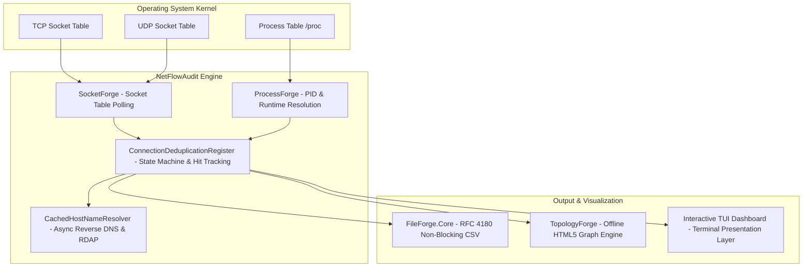
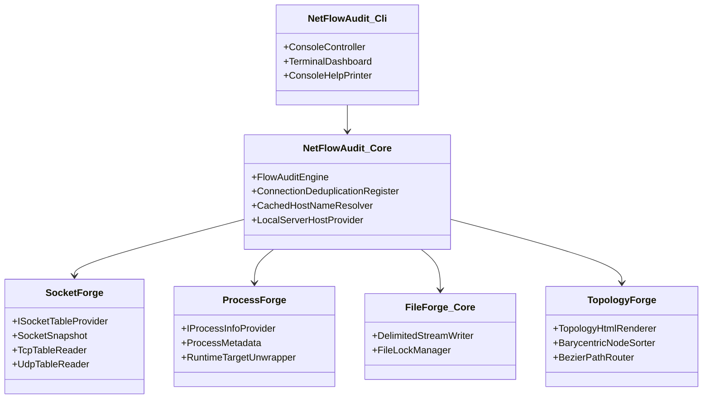
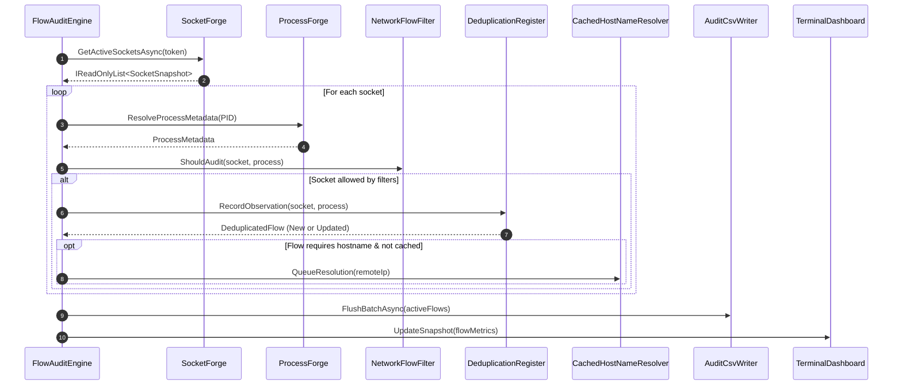

# NetFlowAudit - Architecture & Engineering Specification

## 1. Executive Architecture Summary

**NetFlowAudit** is a lightweight, cross-platform (Windows & Linux) network flow auditing and infrastructure discovery agent. Unlike traditional network capture tools (such as Wireshark or Zeek), NetFlowAudit operates **strictly at the operating system socket layer without packet inspection drivers** (no Npcap, WinPcap, or libpcap required). 

It continuously audits all inbound, outbound, and listening TCP/UDP sockets, correlates them with owning process trees and application runtimes, deduplicates transient connections into consolidated historical flows, and produces both an RFC 4180 CSV audit trail and interactive offline HTML5/SVG topology maps.

---

## 2. Decoupled Shared Framework Architecture

NetFlowAudit adheres to Clean Architecture and strict Dependency Inversion principles. Domain logic and infrastructure adapters are separated across 4 independent, modular shared frameworks maintained in dedicated repositories:

### Framework Roles
1. **SocketForge (`1.0.2`)**:
   - **Windows**: Interacts with `iphlpapi.dll` (`GetExtendedTcpTable`, `GetExtendedUdpTable`) to retrieve IPv4 and IPv6 socket structures (`MIB_TCPTABLE_OWNER_PID`, `MIB_UDPTABLE_OWNER_PID`).
   - **Linux**: Parses kernel socket structures from `/proc/net/tcp`, `/proc/net/tcp6`, `/proc/net/udp`, and `/proc/net/udp6`, mapping inode descriptors to `/proc/[pid]/fd/*`.
2. **ProcessForge (`1.0.2`)**:
   - Gathers executable metadata (`ProcessName`, `ExecutablePath`, `CommandLine`, `UserName`).
   - **Runtime Unwrapping**: Inspects command lines of launcher processes (`dotnet`, `java`, `python`, `node`, `powershell`, `bash`) to extract the genuine application target (e.g. `catalog-service.jar`, `worker.py`, `backup.ps1`).
3. **FileForge.Core (`1.0.2`)**:
   - Implements thread-safe, non-blocking streaming I/O.
   - Enforces strict RFC 4180 escaping (commas, quotes, newlines) and maintains persistent file share locks (`FileShare.ReadWrite`), allowing real-time ingestion by SIEM agents or log shippers without locking conflicts.
4. **TopologyForge (`1.0.6`)**:
   - Generates fully self-contained offline HTML5/SVG network topology visualizations.
   - Incorporates Sugiyama anti-crossing barycentric positioning, smooth Bézier routing around server obstacles, interactive port inspection panels, and client-side pagination.

---

## 3. Data Flow & Processing Pipeline

The audit cycle executes periodically (default every 5 seconds) as an asynchronous loop governed by cooperative cancellation:

### Pipeline Stages

1. **Socket Discovery**:
   - Collects TCP sockets across all states (`Listen`, `Established`, `TimeWait`, `CloseWait`, `FinWait1`, `FinWait2`, `SynSent`, `SynReceived`).
   - Collects active UDP endpoints bound locally.
2. **Process Correlation & Metadata Enrichment**:
   - Maps each socket's owning PID to binary name, path, command line, and executing user context.
   - If the process terminates before resolution, flags ownership as `[Terminated]` while retaining socket metrics.
3. **Multi-Stage Filtering (`NetworkFlowFilter`)**:
   - Evaluates exclusion criteria: Loopback (`127.0.0.1`, `::1`), system accounts, local ports (e.g. 3389, 22), remote ports (e.g. 53 DNS), remote IP CIDR blocks (e.g. `10.0.0.0/8`), process name prefixes, and PIDs (e.g. 0, 4).
4. **Deduplication & State Machine (`ConnectionDeduplicationRegister`)**:
   - Ephemeral client ports (49152–65535 on Windows/Linux) are normalized during deduplication.
   - Distinct connections from the same client binary to the same destination service port are collapsed into a single audit entity tracking `FirstSeenUtc`, `LastSeenUtc`, and cumulative `ObservationCount`.
5. **Non-Blocking Hostname Enrichment (`CachedHostNameResolver`)**:
   - Evaluates CIDR exclusions via `DnsAddressExclusionEvaluator` to skip broadcast, multicast, or link-local lookups.
   - Consults local memory cache and persistent disk cache (`netflow_dns_cache.json`).
   - Queues unresolved public IPs to a background unbounded channel worker with concurrency throttled via `SemaphoreSlim(10, 10)` and bounded timeout (500 ms).
   - If reverse DNS PTR is missing, falls back to RDAP (Registration Data Access Protocol) querying ARIN/RIPE/APNIC/LACNIC/AFRINIC regional registries to resolve organization ownership.
6. **Streaming Persistence & Visualization**:
   - Writes batch changes to disk via `FileForge.Core`.
   - Dispatches state updates to the Spectre.Console TUI and generates/refreshes the `TopologyForge` HTML5 map on demand.

---

## 4. Concurrency & Resource Governance

NetFlowAudit is designed for minimal footprint on high-density production hosts:

- **Cooperative Cancellation**: Every async I/O method accepts a `CancellationToken` and respects graceful shutdown signals (`Ctrl+C`, `SIGTERM`, `SIGINT`).
- **Bounded Worker Queues**: Reverse DNS queries are scheduled through a `Channel<IPAddress>` with a maximum concurrency of 10 workers to avoid socket exhaustion.
- **Lock-Free Cache Access**: The DNS cache uses `ConcurrentDictionary<IPAddress, DnsCacheEntry>`, ensuring that high-frequency packet loops never block on lock contention.
- **Memory Footprint**: Working set memory remains bounded between **35 MB and 65 MB**, even on nodes with over 10,000 active concurrent connections, thanks to deduplication folding.
- **CPU Overhead**: Typical CPU utilization is **< 0.5%** on modern multicore servers with the default 5-second sampling interval.

---

## 5. Security & Isolation Model

| Aspect | Implementation & Rationale |
|---|---|
| **Driverless Execution** | Zero kernel drivers installed; operates in unprivileged user space for self-owned sockets, or local Administrator / `CAP_NET_ADMIN` / `root` to inspect foreign process sockets. |
| **Air-Gapped / Isolated Mode** | When `--offline` or `--isolated` is set, all outbound DNS PTR and RDAP network queries are completely suppressed. No traffic is emitted by NetFlowAudit itself. |
| **Read-Only Inspection** | NetFlowAudit is strictly passive; it never terminates connections, injects packets, or alters socket routing tables. |
| **Data Masking** | Provides runtime obfuscation (`--obfuscate`, `--mask-server`, `--mask-ip`) to anonymize server hostnames and internal IP schemes for external audits or documentation screenshots. |
