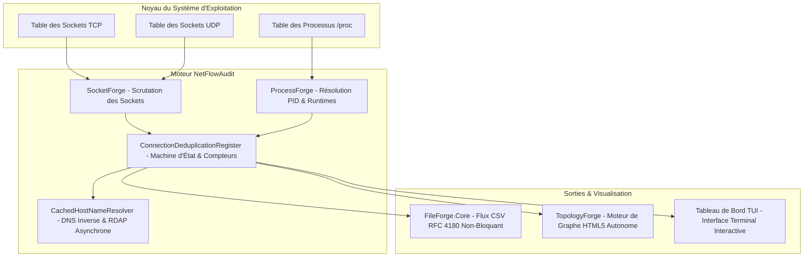
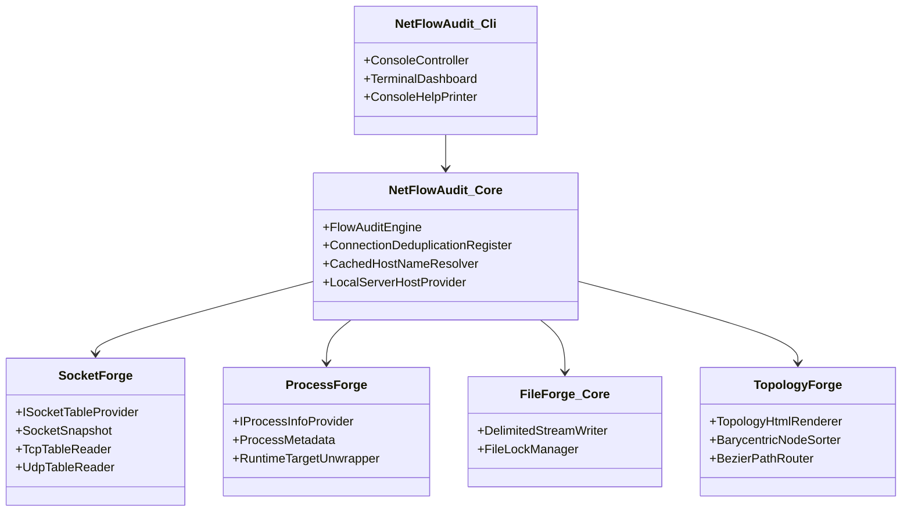
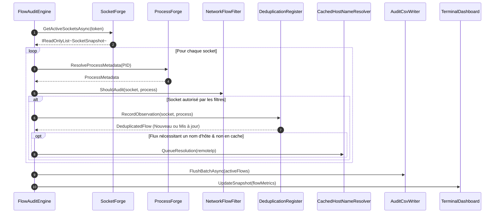

> **Langue / Language**: **[ 🇫🇷 Français ]** · [ 🇬🇧 English (architecture.en.md)](architecture.en.md)

# NetFlowAudit - Spécification d'Architecture & Ingénierie Système

## 1. Résumé Exécutif de l'Architecture

**NetFlowAudit** est un agent d'audit des flux réseau et de cartographie d'infrastructure léger et multiplateforme (Windows & Linux). Contrairement aux outils traditionnels de capture de paquets (tels que Wireshark ou Zeek), NetFlowAudit opère **strictement au niveau de la couche des sockets du système d'exploitation sans pilote de capture de paquets** (aucun pilote Npcap, WinPcap ou libpcap requis).

Il audite en continu l'ensemble des sockets TCP/UDP entrants, sortants et en écoute, les corrèle avec les arborescences de processus propriétaires et les runtimes applicatifs, déduplique les connexions éphémères en flux historiques consolidés, et génère simultanément une piste d'audit CSV conforme au standard RFC 4180 ainsi que des cartographies topologiques HTML5/SVG interactives et autonomes.

---

## 2. Architecture Découplée des Frameworks Partagés

NetFlowAudit respecte scrupuleusement les principes de la Clean Architecture et de l'inversion de dépendance. La logique métier et les adaptateurs d'infrastructure sont répartis entre 4 frameworks partagés modulaires et indépendants :

### Responsabilités des Frameworks
1. **SocketForge (`1.0.2`)** :
   - **Windows** : Interagit avec l'API native `iphlpapi.dll` (`GetExtendedTcpTable`, `GetExtendedUdpTable`) pour extraire les structures des sockets IPv4 et IPv6 (`MIB_TCPTABLE_OWNER_PID`, `MIB_UDPTABLE_OWNER_PID`).
   - **Linux** : Analyse les structures de sockets du noyau depuis `/proc/net/tcp`, `/proc/net/tcp6`, `/proc/net/udp` et `/proc/net/udp6`, en associant les descripteurs d'inodes aux descripteurs `/proc/[pid]/fd/*`.
2. **ProcessForge (`1.0.2`)** :
   - Récupère les métadonnées de l'exécutable (`ProcessName`, `ExecutablePath`, `CommandLine`, `UserName`).
   - **Débrouillage de runtime (*Runtime Unwrapping*)** : Analyse la ligne de commande des lanceurs génériques (`dotnet`, `java`, `python`, `node`, `powershell`, `bash`) afin d'identifier la véritable cible applicative (ex. `catalog-service.jar`, `worker.py`, `backup.ps1`).
3. **FileForge.Core (`1.0.2`)** :
   - Assure des écritures séquentielles thread-safe et non-bloquantes.
   - Applique rigoureusement les règles d'échappement RFC 4180 (virgules, guillemets, retours chariot) et maintient un verrou de partage persistant (`FileShare.ReadWrite`), autorisant la lecture en temps réel par des agents SIEM ou des collecteurs de logs sans conflit de verrouillage.
4. **TopologyForge (`1.1.1`)** :
   - Génère des visualisations topologiques réseau HTML5/SVG interactives 100 % autonomes (zéro dépendance externe).
   - Intègre le placement barycentrique anti-croisement de Sugiyama, l'organisation par colonnes architecturales fonctionnelles (*Functional Tiers*), le regroupement par sous-réseaux et zones de sécurité avec enveloppes à fort contraste et case à cocher interactive, la simulation physique organique dirigée par les forces, le routage de courbes de Bézier lisses contournant les serveurs, les panneaux interactifs d'inspection des ports et la pagination côté client.

---

## 3. Flux de Données & Pipeline de Traitement

Le cycle d'audit s'exécute périodiquement (par défaut toutes les 5 secondes) sous la forme d'une boucle asynchrone gouvernée par l'annulation coopérative (*CancellationToken*) :

### Étapes du Pipeline

1. **Découverte des Sockets** :
   - Collecte les sockets TCP dans tous les états (`Listen`, `Established`, `TimeWait`, `CloseWait`, `FinWait1`, `FinWait2`, `SynSent`, `SynReceived`).
   - Collecte les points de terminaison UDP actifs liés localement.
2. **Corrélation des Processus & Enrichissement des Métadonnées** :
   - Associe le PID propriétaire de chaque socket au nom du binaire, chemin d'accès, ligne de commande et compte utilisateur d'exécution.
   - Si le processus se termine avant sa résolution, l'appartenance est marquée `[Terminated]` tout en conservant les métriques du socket.
3. **Filtrage Multi-Niveaux (`NetworkFlowFilter`)** :
   - Évalue les critères d'exclusion : bouclage local (`127.0.0.1`, `::1`), comptes système, ports locaux (ex. 3389, 22), ports distants (ex. 53 DNS), plages CIDR d'IP distantes (ex. `10.0.0.0/8`), préfixes de noms de processus et PID spécifiques (ex. 0, 4).
4. **Déduplication & Machine d'État (`ConnectionDeduplicationRegister`)** :
   - Les ports clients éphémères (49152–65535 sous Windows/Linux) sont neutralisés lors de la déduplication.
   - Les connexions distinctes issues du même binaire client vers le même port de service distant sont consolidées en une seule entité d'audit horodatée (`FirstSeenUtc`, `LastSeenUtc`) avec un compteur cumulé (`ObservationCount`).
5. **Résolution Asynchrone Non-Bloquante des Noms d'Hôtes (`CachedHostNameResolver`)** :
   - Évalue les exclusions CIDR via `DnsAddressExclusionEvaluator` pour ignorer les résolutions broadcast, multicast ou link-local.
   - Interroge le cache mémoire local puis le cache disque persistant (`netflow_dns_cache.json`).
   - Enfile les adresses IP publiques non résolues dans un canal d'arrière-plan sans blocage avec une concurrence régulée par `SemaphoreSlim(10, 10)` et un délai d'attente borné (500 ms).
   - En cas d'absence d'enregistrement PTR DNS inverse, bascule automatiquement vers le protocole RDAP (*Registration Data Access Protocol*) en interrogeant les registres régionaux ARIN/RIPE/APNIC/LACNIC/AFRINIC pour identifier l'organisation propriétaire.
6. **Persistance en Flux Continu & Visualisation** :
   - Écrit les lots modifiés sur disque via `FileForge.Core`.
   - Transmet les métriques au tableau de bord interactif Spectre.Console TUI et régénère la cartographie HTML5 `TopologyForge` à la demande.

---

## 4. Concurrence & Gouvernance des Ressources

NetFlowAudit est optimisé pour une empreinte minimale sur les serveurs de production à forte charge :

- **Annulation Coopérative** : Chaque méthode d'I/O asynchrone accepte un `CancellationToken` et respecte les signaux de terminaison gracieuse (`Ctrl+C`, `SIGTERM`, `SIGINT`).
- **Files de Travail Régulées** : Les requêtes DNS inverses et RDAP transitent par un `Channel<IPAddress>` avec un parallélisme borné à 10 workers pour prévenir l'épuisement des descripteurs de sockets.
- **Accès au Cache Sans Verrou** : Le cache DNS repose sur un `ConcurrentDictionary<IPAddress, DnsCacheEntry>`, garantissant que les boucles de traitement haute fréquence ne subissent aucune contention de verrou.
- **Empreinte Mémoire Maîtrisée** : La mémoire de travail reste stable entre **35 Mo et 65 Mo**, y compris sur les nœuds gérant plus de 10 000 connexions concurrentes actives, grâce au pliage opéré par la déduplication.
- **Consommation CPU Négligeable** : La charge CPU typique est **< 0,5 %** sur les processeurs modernes avec l'intervalle de scrutation par défaut de 5 secondes.

---

## 5. Modèle de Sécurité & d'Isolation

| Aspect | Implémentation & Justification Technique |
|---|---|
| **Exécution Sans Pilote** | Aucun pilote en espace noyau installé ; s'exécute en espace utilisateur standard pour les sockets appartenant à l'utilisateur, ou avec privilèges Administrateur / `CAP_NET_ADMIN` / `root` pour auditer l'ensemble des processus de la machine. |
| **Mode Isolé / Air-Gap** | Lorsque `--offline` ou `--isolated` est activé, toutes les requêtes réseau sortantes DNS PTR et RDAP sont rigoureusement désactivées. Aucun paquet réseau n'est émis par NetFlowAudit. |
| **Inspection Passive en Lecture Seule** | NetFlowAudit est strictement passif ; il n'interrompt jamais de connexion, n'injecte aucun paquet et ne modifie aucune table de routage ou de socket. |
| **Obscurcissement des Données** | Propose l'anonymisation à l'exécution (`--obfuscate`, `--mask-server`, `--mask-ip`) pour masquer les noms d'hôtes et plans d'adressage IP internes lors des audits externes ou captures d'écran de documentation. |
