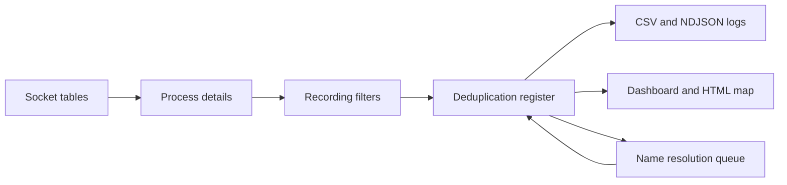

> **Language / Langue**: [English](architecture.md) · **Français**

# Fonctionnement de PortAtlas

PortAtlas répond à une question : avec quels services une machine communique-t-elle, sur des jours ou des semaines, et quel programme en est à l'origine ? Cette page explique comment l'agent obtient cette réponse et pourquoi il est construit ainsi. Les options et formats exacts sont dans la [référence](../reference/cli.fr.md).

## Lire les sockets plutôt que capturer les paquets

L'agent lit les tables de sockets que le système tient déjà :

- sous Windows, par l'API IP Helper (`GetExtendedTcpTable`, `GetExtendedUdpTable`), qui donne l'identifiant du processus de chaque socket ;
- sous Linux, en lisant `/proc/net/tcp`, `tcp6`, `udp` et `udp6`, puis en rapprochant l'inode de chaque socket des descripteurs de `/proc/<pid>/fd`.

Aucun pilote de capture (Npcap, libpcap) n'est installé et aucun paquet n'est lu. L'agent voit les connexions, pas leur contenu, et seulement celles ouvertes au moment d'un balayage : une connexion ouverte et fermée entre deux balayages n'est pas vue. Réduire `--interval` réduit cet écart.

Lire `/proc/<pid>/fd` d'un processus d'un autre utilisateur demande root. Sans root, les sockets de ces processus sont listés mais ne sont rattachés à aucun processus. Sous Windows, le chemin, la ligne de commande et le compte des processus d'autres comptes ne sont pas lisibles sans invite élevée ; ces champs restent alors vides.

## Le cycle de balayage

Toutes les `ScanIntervalSeconds` secondes, `FlowAuditEngine` :

1. lit les sockets par SocketForge et le processus de chaque socket par ProcessForge, qui trouve aussi l'application lancée par un lanceur comme `java -jar`, `python` ou `powershell` ;
2. écarte les sockets retenus par les filtres d'enregistrement (`NetworkFlowFilter` pour les ports, les adresses et le trafic de bouclage, `ProcessExclusionFilter` pour les processus) ;
3. transmet le reste à `ConnectionDeduplicationRegister`, qui met à jour ou crée une entrée par flux ;
4. écrit les entrées modifiées dans le journal CSV, et dans le journal NDJSON s'il est activé.

## Pourquoi dédupliquer les flux

Un client ouvre un nouveau port local à chaque connexion. Journaliser chaque connexion produirait une ligne par port et par balayage. Le registre identifie un flux sans le port client (voir les [formats de sortie](../reference/output-formats.fr.md#journal-daudit-csv)) : un service utilisé des milliers de fois garde une seule ligne, avec une date de première observation, une date de dernière observation et un compteur. Relire le journal CSV au démarrage conserve ces valeurs d'un redémarrage à l'autre.

## Résolution de noms

Les adresses distantes sont nommées en arrière-plan, pour qu'un serveur DNS lent ne retarde jamais un balayage. `CachedHostNameResolver` :

- répond depuis les alias statiques (`CustomHostAliases`, `--alias`), puis depuis son cache mémoire et le fichier de cache (`DnsCacheFilePath`) ;
- ignore les adresses de `DnsExcludedNetworks` (diffusion, multidiffusion, lien local) ;
- sinon met l'adresse en file ; dix résolutions au plus tournent en même temps, chaque requête DNS inverse attendant au plus `DnsResolutionTimeoutMs` (3 secondes par défaut) ;
- distingue les deux façons dont une requête peut échouer. Un serveur qui ne répond pas à temps n'est pas un enregistrement absent : rien n'est mis en cache et l'adresse est reposée une minute plus tard. Une réponse indiquant qu'aucun enregistrement n'existe est mise en cache comme nom vide et reposée 24 heures plus tard, pour qu'un enregistrement ajouté ensuite à la zone DNS finisse par être trouvé ;
- pour une adresse publique, demande aussi au service RDAP `rdap.org` l'organisation propriétaire du bloc d'adresses, sauf si `ResolveIpOwners` vaut `false` ou si `--no-rdap` est donné ; le nom DNS est gardé quand il existe, l'organisation sert sinon. Après deux échecs RDAP consécutifs, les requêtes RDAP sont suspendues 60 secondes.

`--no-dns` (`ResolveRemoteHostNames: false`) coupe tout le résolveur : aucune requête DNS ni RDAP n'est envoyée et les alias ne s'appliquent pas.

`--no-rdap` existe pour les serveurs sans accès Internet : RDAP n'y ferait qu'expirer, alors que le DNS inverse atteint toujours le serveur DNS local. `resolve` complète les noms plus tard sur une machine connectée, et `resolve --cache-only` travaille à partir des caches collectés sans envoyer de requête.

## Frameworks partagés

Le programme est réparti entre l'application et quatre frameworks publiés en paquets NuGet, réutilisés par d'autres projets :

| Paquet | Rôle dans PortAtlas |
| :--- | :--- |
| SocketForge 1.1.0 | Tables de sockets sous Windows et Linux |
| ProcessForge 1.1.1 | Informations et compte des processus, cibles des lanceurs, exclusion de processus |
| FileForge.Core 1.1.0 | Écriture CSV et NDJSON qui laisse les fichiers lisibles par d'autres programmes pendant l'audit |
| TopologyForge 1.8.0 | Graphe topologique, filtres, carte HTML et export Draw.io |

L'application (`PortAtlas.Core`, `PortAtlas`) contient ce qui est propre à l'audit : le cycle de balayage, la déduplication, la résolution de noms, la ligne de commande, le tableau de bord et les exports.

## Ligne de commande

Chaque commande déclare les options qu'elle lit avec System.CommandLine ; les mêmes définitions produisent l'analyseur et le texte d'aide. Les raisons de ce choix sont consignées dans l'[ADR-0001](../adr/0001-system-commandline-subcommands.md).

## Modèle de sécurité

| Aspect | Comportement |
| :--- | :--- |
| Trafic réseau | L'agent envoie des requêtes DNS inverses et, pour les adresses publiques, des requêtes RDAP à `rdap.org`. `--no-rdap` désactive RDAP ; `--no-dns` désactive les deux. Il ne se connecte jamais aux machines auditées. |
| Modifications de la machine | Aucune : l'agent ne fait que lire les tables de sockets et de processus. |
| Privilèges | Administrateur ou root est nécessaire pour rattacher chaque socket à son processus (voir plus haut). |
| Données collectées | Les lignes de commande peuvent contenir des secrets passés en argument ; protégez les journaux en conséquence. |
| Captures d'écran | `--mask-server`, `--mask-ip` et `--obfuscate` masquent le nom et l'adresse du serveur dans le tableau de bord uniquement. |
