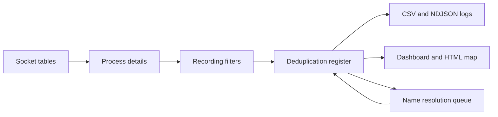

> **Language / Langue**: **English** · [Français](architecture.fr.md)

# How NetFlowAudit works

NetFlowAudit answers one question: which services does a machine talk to, over days or weeks, and which program is responsible? This page explains how the agent collects that answer and why it is built this way. The exact options and formats are in the [reference](../reference/cli.md).

## Reading sockets instead of capturing packets

The agent reads the socket tables the operating system already keeps:

- on Windows, through the IP Helper API (`GetExtendedTcpTable`, `GetExtendedUdpTable`), which gives the process identifier of each socket;
- on Linux, by reading `/proc/net/tcp`, `tcp6`, `udp` and `udp6`, then matching each socket inode with the descriptors in `/proc/<pid>/fd`.

No capture driver (Npcap, libpcap) is installed and no packet is read. The agent sees connections, not their content, and only those open at the moment of a scan: a connection that opens and closes between two scans is not seen. Lowering `--interval` reduces that gap.

Reading `/proc/<pid>/fd` of another user's process needs root. Without it, the sockets of those processes are still listed but are not attributed to a process. On Windows, the path, command line and account of processes of other accounts cannot be read without an elevated prompt; those fields then stay empty.

## The scan cycle

Every `ScanIntervalSeconds` seconds, `FlowAuditEngine`:

1. reads the sockets through SocketForge and the process of each socket through ProcessForge, which also finds the application started by a launcher such as `java -jar`, `python` or `powershell`;
2. drops the sockets matched by the recording filters (`NetworkFlowFilter` for ports, addresses and loopback traffic, `ProcessExclusionFilter` for processes);
3. hands the rest to `ConnectionDeduplicationRegister`, which updates or creates one entry per flow;
4. writes the changed entries to the CSV log, and to the NDJSON log when enabled.

## Why flows are deduplicated

A client opens a new local port for each connection. Logging every connection would produce one line per port and per scan. The register identifies a flow without the client port (see [output formats](../reference/output-formats.md#csv-audit-log)), so that a service used thousands of times keeps one line with a first-seen date, a last-seen date and an observation count. Reloading the existing CSV log at startup keeps those values across restarts.

## Name resolution

Remote addresses are named in the background so that a slow DNS server never delays a scan. `CachedHostNameResolver`:

- answers from the static aliases (`CustomHostAliases`, `--alias`), then from its memory cache and the cache file (`DnsCacheFilePath`);
- skips the addresses of `DnsExcludedNetworks` (broadcast, multicast, link-local);
- otherwise queues the address; ten resolutions run at most at the same time, each reverse DNS query waiting at most `DnsResolutionTimeoutMs` (3 seconds by default);
- keeps apart the two ways a query can fail. A server that does not answer in time is not a missing record: nothing is cached and the address is asked again one minute later. An answer that no record exists is cached as an empty name and asked again 24 hours later, so that a record added later to the DNS zone is eventually found;
- for a public address, also asks the RDAP service `rdap.org` for the organisation that owns the address block, unless `ResolveIpOwners` is `false` or `--no-rdap` is given; the DNS name is kept when there is one, the organisation is used otherwise. After two consecutive RDAP failures, RDAP queries pause for 60 seconds.

`--no-dns` (`ResolveRemoteHostNames: false`) turns the whole resolver off: neither DNS nor RDAP queries are sent, and aliases are not applied.

`--no-rdap` exists for servers without Internet access: RDAP would only time out there, while reverse DNS still reaches the local DNS server. `resolve` completes the names later on a connected machine, and `resolve --cache-only` works from collected caches without sending any query.

## Shared frameworks

The program is split between the application and four frameworks published as NuGet packages, reused by other projects:

| Package | Role in NetFlowAudit |
| :--- | :--- |
| SocketForge 1.1.0 | Socket tables on Windows and Linux |
| ProcessForge 1.1.1 | Process details and account, launcher targets, process exclusion |
| FileForge.Core 1.1.0 | CSV and NDJSON writers that keep the files readable by other programs while the audit runs |
| TopologyForge 1.5.2 | Topology graph, filters, HTML map and Draw.io export |

The application (`NetFlowAudit.Core`, `NetFlowAudit.Cli`) holds what is specific to the audit: the scan cycle, deduplication, name resolution, the command line, the dashboard and the exports.

## Command line

Each command declares the options it reads with System.CommandLine; the same definitions produce the parser and the help text. The reasons for this choice are recorded in [ADR-0001](../adr/0001-system-commandline-subcommands.md).

## Security model

| Aspect | Behaviour |
| :--- | :--- |
| Network traffic | The agent sends reverse DNS queries and, for public addresses, RDAP queries to `rdap.org`. `--no-rdap` disables RDAP; `--no-dns` disables both. It never connects to the audited peers. |
| Changes to the machine | None: the agent only reads socket and process tables. |
| Privileges | Administrator or root is needed to attribute every socket to its process (see above). |
| Collected data | Command lines can contain secrets passed as arguments; protect the audit logs accordingly. |
| Screenshots | `--mask-server`, `--mask-ip` and `--obfuscate` hide the server name and address in the dashboard only. |
